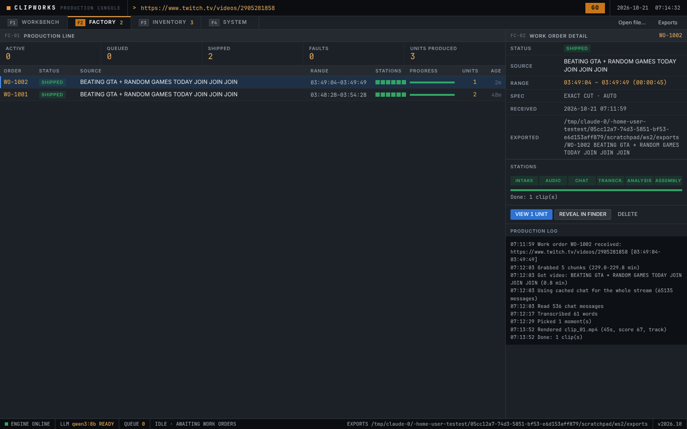
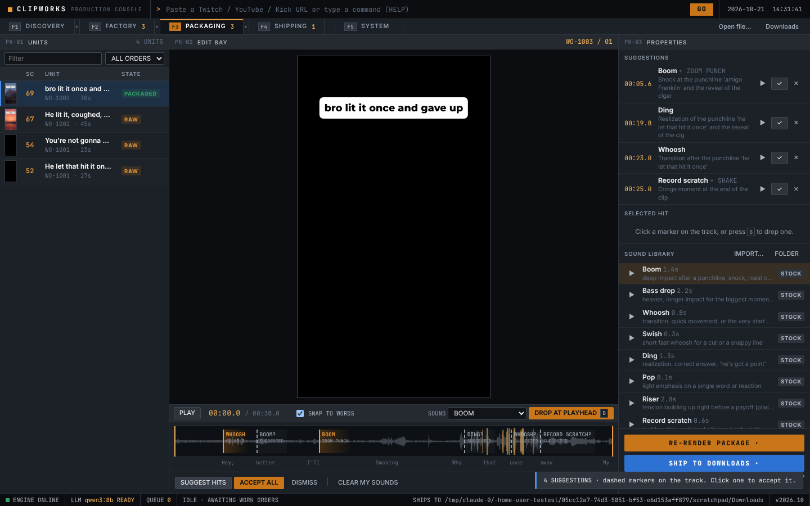
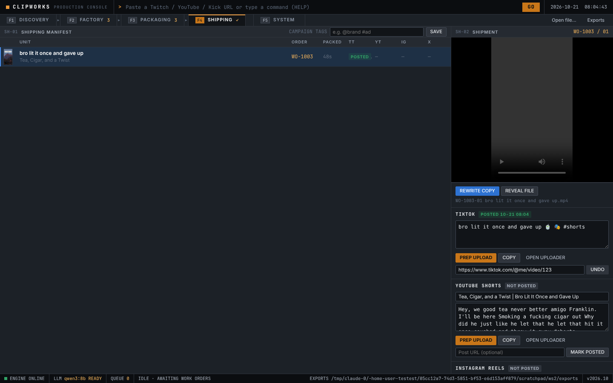

# Clipworks

Local clip factory for streams and long videos. Paste a stream before bed, wake up to a
stack of finished 9:16 clips with captions and hooks, ranked best first. Everything runs on
your Mac. No accounts, no uploads, no subscription.

## Install (Mac, Apple Silicon)

1. Download **[Clipworks.dmg](https://github.com/cooldude292/testest/releases/download/clipworks-latest/Clipworks.dmg)**.
2. Open it and drag Clipworks into Applications.
3. Open Clipworks. macOS will refuse the first time because the app isn't signed with
   a paid Apple developer account. Go to **System Settings → Privacy & Security**, scroll
   down, click **Open Anyway**. You only do this once.
   (Terminal alternative: `xattr -dr com.apple.quarantine /Applications/Clipworks.app`)

On first launch the System page downloads the AI models (about 7GB total: the
language model, the speech model, and Ollama if you don't have it). You can load
footage while that runs; the factory starts once they're ready.

## How it works

Four stations, left to right, on <kbd>F1</kbd>–<kbd>F4</kbd> (<kbd>F5</kbd> is System):

**F1 Discovery: pick streams.** The front page is the **Overnight run** box. Paste one link per
line and hit **Queue for tonight**:
- a Twitch VOD (`twitch.tv/videos/...`)
- a Twitch channel (`twitch.tv/name`), which means its latest past broadcast
- a YouTube video, a Kick VOD, or a file

Pick how many clips you want per stream (default 15) and how long. Streams run one after
another, and the Mac is kept awake while they do (plug it in and leave the lid open). You
can also type `AUTO <link> <link>` in the command line.

What happens to each stream:
1. **Audio only, whole stream.** Twitch has an audio rendition, so 4 hours downloads in a
   minute or two. No video yet.
2. **Audience signals for every second**: how fast chat is going, chat literally asking for a
   clip ("CLIP IT", "someone clip that"), clips viewers already made of the VOD (weighted by
   their views, so other people's clip bots don't count), YouTube's most-replayed graph, loudness.
3. **Candidates**: the strongest 25 to 120 spots. With no audience signal at all (a file, a
   YouTube video without the graph) the AI reads the whole transcript to propose them.
4. **Transcribe** around the candidates, in 10 minute chunks.
5. **Judge.** The AI looks at each candidate with the transcript *and* what chat typed (chat
   says what happened on screen, which the transcript can't). It cuts tight boundaries, scores
   standalone / payoff / first seconds, and rejects junk: raids, sub trains, TTS, reading chat,
   loading screens, inside jokes. It thinks before answering, which is slow and worth it.
6. **Head to head.** Survivors are ranked against each other in small heats, a few rounds.
7. **Video for the winners only**, then reframe and captions. Results land in Packaging.

A 4 hour stream takes roughly 1 to 2 hours on an M-series Mac. Every step saves to disk, so if
something dies, **Re-run** picks up where it stopped. Each pick shows what happens in it and
why it was chosen ("viewers clipped this", "chat asking for a clip").

How the signals were chosen: measured on 8 Twitch VODs from 5 streamers (33 hours, 650k chat
messages) against the 900+ clips viewers made of them. Chat speed alone put 18% of clip views
in its top 20 picks; speed plus "clip it" 39%. Word lists for laughing/shock/hype looked great
tuned on one streamer and fell apart on the others, so they're only used to explain picks.

**Picking by hand still works.** Paste a link in the command line and press GO: the source
plays in the monitor over the chat/most-replayed timeline. Drag on the timeline or press
<kbd>I</kbd>/<kbd>O</kbd> to mark a range, then dispatch it:
- **AI selection**: the factory finds the best clips inside your range.
- **Exact cut**: your range is the clip (3 s to 3 min).
- **Auto-clip whole stream** queues the loaded source for an overnight run.

**F2 Factory: watch it work.** Every work order moves through its stations. Overnight runs show
the ranked picks with what happens and why; click one to open it in Packaging.

**F3 Packaging: you do the sounds, it helps.** The edit bay for each clip:
- A sound effects track under a live preview, with the clip's waveform drawn behind it so
  you can see the yells and laughs. Pick a sound, press <kbd>B</kbd> to drop it at the
  playhead, drag markers to move them, arrows to nudge. **Snap to words** locks hits onto
  word starts and ends.
- **Suggest hits** asks the AI where sounds could land. Suggestions show up as dashed
  markers with a reason ("boom: right after the punchline"). Nothing is added until you
  accept one (click it, or ✓ in the list). Dismiss the rest.
- Each sound can carry a visual hit: zoom punch, shake or white flash.
- Edit the hook, toggle and recolor captions, fix misheard words in the transcript, trim.
- **Render package** makes the final file. Audio is normalized to TikTok loudness (-14 LUFS)
  so effects punch without blowing ears out.
- The stock sounds (boom, bass drop, whoosh, swish, ding, pop, riser, record scratch,
  error buzz, glitch, camera shutter, heartbeat) are generated by the app itself. Import any
  mp3/wav you want (the real vine boom, bruh, etc.) and it joins the library.

**F4 Shipping: into your Downloads.** Every packaged clip is listed with its status.
**Ship** copies the final mp4 into `~/Downloads` with a clean name
(`<hook> (WO-1003-01).mp4`); **Ship all ready** does every one that hasn't gone out yet.
You can also ship straight from Packaging once a render finishes.

Commands you can type: `AUTO <links>`, a URL or file path, `DIS` `FAC` `PKG` `SHIP` `SYS`, `IN`,
`OUT`, `SEND`, `WO 1001`, `HELP`.

Layouts, picked automatically unless you choose one:
- **Facecam / gameplay** when there's a webcam overlay
- **Follow speaker** for podcasts and just chatting
- **Gameplay zoom** when there are no faces
- **Full frame / blur** and **Center crop** if you want them

## Building

GitHub Actions builds the DMG on a macOS runner on every push to this branch
(`.github/workflows/mac-app.yml`), runs a self-test against the packaged app
(transcription, rendering, Twitch loading, and a real Ollama call), and publishes
it to the `clipworks-latest` release.

Locally on a Mac: `pip install -r requirements-app.txt && bash packaging/build_mac.sh`.

Developer mode without packaging: `./start.sh` runs the same engine and opens the UI
in your browser.

## Settings

Environment variables, mostly for development:

| Variable | Default | What |
|---|---|---|
| `CLIPPER_LLM` | `qwen3:8b` | Any Ollama model. `qwen3:14b` is smarter, fits in 24GB, and is worth it for overnight runs. |
| `CLIPPER_JUDGE_THINK` | `1` | `0` makes the judge answer without reasoning first. Faster, less picky. |
| `CLIPPER_WHISPER` | `mlx-community/whisper-large-v3-turbo` | Any MLX Whisper repo. |
| `CLIPPER_COOKIES_FROM` | unset | `chrome`, `safari`, `firefox`... use that browser's logins for downloads. |

## Known rough edges

- Unsigned app, so the one-time Open Anyway step.
- YouTube sometimes demands a login. Clipworks retries with your browser's cookies;
  macOS may ask for Keychain access when it does.
- Speaker tracking watches mouths, not audio. Fast back-and-forth can fool it.
- A really tiny facecam might not get detected; you'll get the gameplay zoom instead.
- Reaction content can come out confusing, since the clip shows the reaction but not
  always what they're reacting to.
- The judge can't see the video. Pure visual moments only get through if chat or viewer
  clips make it obvious. The most-viewed viewer clips always survive the judge for that reason.
- A laptop with the lid closed sleeps no matter what. Leave it open and plugged in.
- The LLM's virality score is a guess. Watch the clips.
